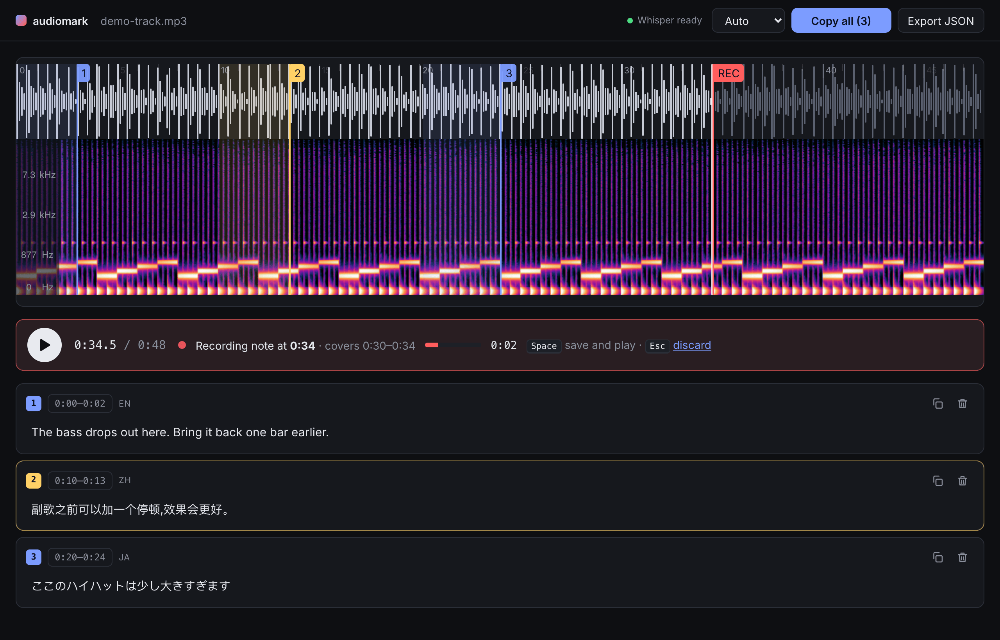

# audiomark

**Annotate audio by talking to it.** Drop in a track, listen, and press <kbd>Space</kbd> whenever
you have something to say. The track pauses, your mic records, and a local Whisper model turns
the note into text while you keep listening.



## Features

- **One key, no context switch.** <kbd>Space</kbd> pauses and starts recording; <kbd>Space</kbd>
  again saves the note and resumes playback instantly. Transcription runs in the background.
- **See what you hear.** Waveform, timeline, and a mel spectrogram with frequency labels.
- **Notes know their place.** Each note is pinned where you paused and covers the stretch you
  listened to before it, shown as a numbered marker and band on the waveform.
- **Multilingual.** Whisper large-v3-turbo with auto language detection (Chinese, English,
  Japanese, Korean, Cantonese, …). Chinese comes out in Simplified characters.
- **Fully local.** Audio and voice never leave your machine. On Apple Silicon a 4-second note
  transcribes in about half a second via MLX.
- **Take it with you.** Copy every note as `[start–end] text` with one click, or export JSON.
  Edit any transcript inline; notes survive a page reload.

## Quick start

Requirements: Node 26+, [pnpm](https://pnpm.io) 12+, [uv](https://docs.astral.sh/uv/).

```sh
git clone https://github.com/GalvinGao/audiomark.git
cd audiomark
pnpm install
(cd server && uv sync)
pnpm dev
```

Open <http://localhost:5173> and drop an audio file onto the page. The first server start
downloads the Whisper model (about 1.6 GB); the status dot in the top bar turns green when it is
ready.

## Keys

| Key                       | While listening  | While recording a note                |
| ------------------------- | ---------------- | ------------------------------------- |
| <kbd>Space</kbd>          | Pause and record | Save the note and resume              |
| <kbd>Esc</kbd>            |                  | Discard the note                      |
| <kbd>←</kbd> <kbd>→</kbd> | Skip 5 s         | Move the playhead; the note stays put |

Click a note's time range to move the playhead there. Click a marker on the waveform to select
its note. Moving the playhead never starts or stops playback, and never moves the note you are
recording; after you save, playback resumes from wherever the playhead is.

## How it works

```
web/      Vite + React + wavesurfer.js   →  POST /api/transcribe (audio/webm)
server/   FastAPI + Whisper              →  { text, language }
```

The browser keeps one microphone stream open, so each note starts with no delay. Every note is a
separate `MediaRecorder` clip, uploaded on save while playback has already resumed.

The server picks a Whisper backend at startup:

| Backend  | Used when                        | Default model                          |
| -------- | -------------------------------- | -------------------------------------- |
| `mlx`    | Apple Silicon (mlx-whisper)      | `mlx-community/whisper-large-v3-turbo` |
| `faster` | everywhere else (faster-whisper) | `large-v3-turbo`                       |

Configure it with environment variables:

| Variable               | Purpose                                      |
| ---------------------- | -------------------------------------------- |
| `WHISPER_BACKEND`      | `mlx` or `faster`                            |
| `WHISPER_MODEL`        | Model name, Hugging Face repo, or local path |
| `WHISPER_DEVICE`       | `faster` only: `cpu`, `cuda`, or `auto`      |
| `WHISPER_COMPUTE_TYPE` | `faster` only: `int8`, `float16`, …          |

For example, a smaller model on the CPU backend: `WHISPER_BACKEND=faster WHISPER_MODEL=small pnpm dev`.

## Development

```sh
pnpm dev:web      # Vite only, port 5173
pnpm dev:server   # API only, port 8787
pnpm build        # typecheck + production build
pnpm lint         # oxlint
pnpm fmt          # oxfmt
```

## License

[MIT](LICENSE)
